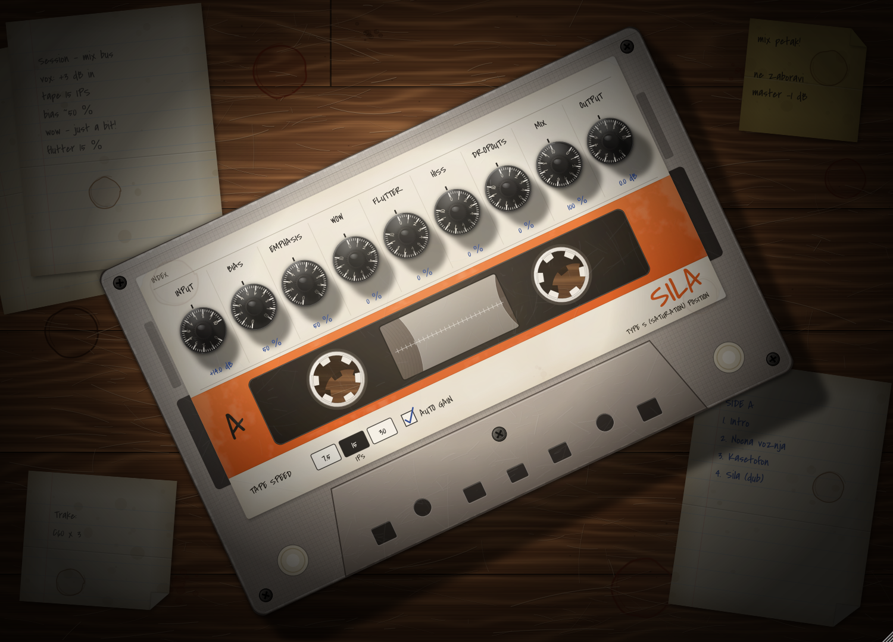

# Sila 0.3.0

**Sila** je tape saturation plugin (VST3 + Standalone, Windows x64) by Voyagersquare.
Sučelje je kazeta koja leži na drvenom stolu među papirima s bilješkama. Kontrole su crni bakelitni
brojčanici (0–10) na INDEX naljepnici; trenutna vrijednost je ispod crne oznake iznad brojčanika.
Čim se plugin otvori, koluti se okreću kao u kasetofonu: manji namotaj vrti se brže, a traka se
polako premotava s lijevog na desni kolut. Sav tekst je ručno pisan (font Covered By Your Grace). Kaseta je položena ukoso, nagnuta 25° ulijevo; sjene i dalje padaju od lampe, dolje desno.
Sve izgleda staro i korišteno: izgrebana i zaprljana kaseta, požutjela naljepnica s izlizanom narančastom
bojom, izgreban stol s mrljama od soka i stari papiri s mrljama, preklopima i savijenim kutovima. Svjetlo dolazi
od stolne lampe gore lijevo: najsvjetlije je na sredini kasete, prema rubovima stola tamnije, a sjene padaju dolje desno.



## Kontrole

| Kontrola | Raspon | Što radi |
|---|---|---|
| **INPUT** | −12 … +24 dB | Koliko jako signal udara u traku. Više = više harmonika i mekše kompresije. |
| **BIAS** | 0 … 100 % | Nizak bias (under-bias): asimetrično, više parnih harmonika, svjetlije. Visok bias (over-bias): simetrično, glađe, tamnije. |
| **WOW** | 0 … 100 % | Sporo titranje visine tona (~0,55 Hz + nasumični drift). |
| **FLUTTER** | 0 … 100 % | Brzo titranje (6,3 Hz + 11,7 Hz). |
| **EMPHASIS** | 0 … 100 % | Pre-/de-emphasis (0–12 dB). Visoke frekvencije ranije ulaze u zasićenje, a ukupni odziv ostaje ravan. |
| **HISS** | 0 … 100 % | Šum trake (svijetli "šššš"). Sporija traka šumi više; na 100 % oko −43 dBFS. Čuje se i u tišini, kao prava traka. |
| **DROPOUTS** | 0 … 100 % | Kratka ispadanja signala (20–120 ms, do −20 dB) kao na izlizanoj traci; tijekom ispadanja prvo nestaju visoke. Više = češće i dublje. |
| **MIX** | 0 … 100 % | Dry/wet. Dry je poravnat s latencijom, pa nema faznih problema. |
| **OUTPUT** | −24 … +12 dB | Izlazna razina. |
| **TAPE SPEED** | 7.5 / 15 / 30 IPS | 7.5: toplije, veći head bump (~55 Hz), visoke padaju od ~11 kHz, više wow/fluttera. 30: čišće i otvorenije. |
| **AUTO GAIN** | uklj./isklj. | Izlaz se spušta za isto koliko je INPUT podignut — za pošteno A/B uspoređivanje. |

Dvoklik na kotačić vraća zadanu vrijednost. Prozor se može povećati/smanjiti (50–150 %).

## Obrada signala

```text
INPUT → pre-emphasis → 4x oversampling: magnetska histereza trake (Jiles–Atherton, RK2)
      → de-emphasis → head bump + low cut + HF roll-off (ovisno o brzini)
      → wow & flutter (modulirana linija kašnjenja) → AUTO GAIN → MIX (dry poravnat) → OUTPUT
```

Srce plugina je fizikalni model magnetiziranja trake (Jiles–Atherton histereza, isti pristup kao u
CHOW Tape modelu, Chowdhury, DAFx 2019), a ne obična `tanh` krivulja. Traka "pamti" smjer signala,
pa glasni dijelovi dobivaju meku kompresiju, 3. harmonik i lagano zaobljene tranzijente.

- **Kalibracija:** sinus na −14 dBFS je referentna razina trake (0 VU). Na INPUT 0 dB miks na
  masteru već jasno ulazi u traku (oko 4 % harmonika na −12 dBFS, vrhovi blizu 0 dBFS
  komprimirani za nekoliko dB). Tihi signal prolazi gotovo neizmijenjen.
- **BIAS** mijenja širinu histereze: under-bias je prljaviji, s parnim harmonicima; over-bias je
  glađi i tamniji.
- **Head bump:** 7.5 IPS +3,5 dB oko 60 Hz, 15 IPS +2,5 dB oko 95 Hz, 30 IPS +1,5 dB oko 150 Hz.

Latencija je fiksna (oversampling FIR + osnovno kašnjenje transporta, ~2–3 ms) i javlja se DAW-u.
Opterećenje procesora: oko 7 % jedne jezgre za stereo na 44,1 kHz.

## Build

Windows: pokreni `Build-Windows.cmd` (Visual Studio 2022 s C++ i CMake alatima).
GitHub Actions gradi VST3 + Standalone, pokreće testove i pluginval (strictness 5) te objavljuje prijenosni paket.

```bash
cmake -S . -B build -DCMAKE_BUILD_TYPE=Release
cmake --build build --parallel
ctest --test-dir build --output-on-failure
```

## Licenca

GPL-3.0. Koristi JUCE 8.0.6 (GPL), VST3 SDK i font Covered By Your Grace (Kimberly Geswein, SIL OFL 1.1, `Assets/Fonts/OFL.txt`).
